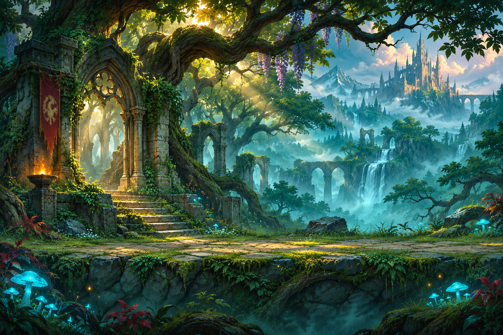

# Пепел семи королевств / Ash of the Seven Kingdoms

**A hand-painted 2D dark-fantasy action RPG by Play Everywhere.**

Проект создан как первый играбельный пролог для Android и Windows на **Godot 4.4.1 (GDScript)**. Визуальная основа — оригинальный живописный фон зачарованного леса, иллюстрированный Страж Пламени, заклинания, атмосферные частицы и освещение.

### Обновлённый Страж Пламени

Главный герой собран из 16 оригинальных иллюстрированных деталей: воронёные доспехи с золотыми драконьими узорами, открытый шлем, алый плащ и светящийся амулет. `scripts/Flamewarden.gd` управляет артикулированной анимацией с двухзвенной кинематикой рук и ног. Цикл бега зависит от пройденного расстояния, опорные стопы остаются у земли; дыхание, прыжок, падение, пружинящее приземление, три визуальных варианта удара, магия, получение урона и смерть имеют отдельные позы. Девять текстурированных полос плаща колышутся с запаздыванием, подвески движутся отдельно. Пауза замораживает анимацию, возрождение сбрасывает позу. Варианты ударов сохраняют прежние урон, дальность и перезарядку.

Проверка `tests/character_smoke.gd` упражняет переходы состояний и связь с игровыми событиями. Задание `character-review` в GitHub Actions рендерит лист из девяти поз настоящим OpenGL-рендерером и сохраняет `Flamewarden-character-review` в артефактах.



## Начать играть

1. Установи **Godot 4.4.1 Standard** (без Mono/C#).
2. Открой `project.godot` в Godot Project Manager.
3. Дождись импорта ресурсов и нажми **F6** для текущей сцены или **F5** для запуска игры.
4. Нажми **Enter** (или **«Пробудиться»**), чтобы начать.

**На Windows:** в GitHub Actions настроена проверка проекта и экспорт Windows-демо. Если workflow успешно завершился, скачай артефакт `Ash-of-the-Seven-Kingdoms-Windows` со страницы `Actions`. Статус сборки не подтверждён до первого запуска workflow.

**На Android:** выставлена альбомная ориентация, сенсорные элементы управления и добавлен экспортный пресет `Android` с пакетом `com.playeverywhere.ashofsevenkingdoms`. Первый APK потребуется экспортировать и проверить на устройстве: готовой проверенной APK-сборки пока нет. Для экспорта из Godot установи Android SDK, JDK и Android Export Templates согласно официальной документации Godot. Для Play Console впоследствии понадобится собственная постоянная подпись AAB.

## Управление

| Действие | Клавиатура | Сенсорный экран |
|---|---|---|
| Идти | `A / D` или `← / →` | стрелки снизу слева |
| Прыгнуть | `Space`, `W`, `↑` | кнопка `↑` |
| Меч | `J`, `Z` | кнопка `⚔` |
| Огненный снаряд | `K`, `X` | кнопка `✦` |
| Поговорить / активировать | `E`, `F` | кнопка `E` |
| Пауза | `P`, `Esc` | `Ⅱ` |
| Сменить язык | `F1` | `RU / EN` на главном экране |
| Решение в конце пролога | `F` / `G` | выбрать один из двух вариантов |

## Что уже реализовано

- Четыре последовательные части первого приключения: **Храм пробуждения → Изумрудная чаща → Пепельный хутор → Святилище Морвена**.
- Перемещение, прыжок, меч с перезарядкой, огненная магия с расходом и восстановлением маны.
- Три типа врагов: **волки, призраки, культисты**; ближний и дистанционный бой.
- Босс **Морвен**, серия атак, полоска здоровья, изменение темпа в конце боя.
- Выбор между **освобождением** и **поглощением** силы первого драконьего сердца.
- Контрольные точки, сохранение в `user://ash_save.json` и возрождение.
- Фоновая атмосфера, частицы, магические эффекты, оригинальные синтезированные музыка и звуки.
- Русский и английский интерфейсы; сенсорные кнопки для мобильного экрана.
- GitHub Actions для импорта ресурсов, проверки запуска и создания Windows-билда.

### Важные ограничения текущей версии

Это **ранний игровой прототип, а не готовая RPG**. Пока нет семи королевств, инвентаря, сменной экипировки, кат-сцен, боёв с драконами и законченного контента на 10–15 минут. Герой использует иллюстрированные детали и программную анимацию; враги пока отрисовываются простыми фигурами. Фон один и меняется тоном и деталями локаций. Производительность и управление на физическом Android-устройстве проверяются отдельно.

## Структура

```text
art/                     art, title icon and a painted forest panorama
audio/                   original synthesized background music and effects
scenes/Main.tscn         scene with root and audio playback
scripts/Game.gd          gameplay, rendering, combat, UI, mobile input, save system
.github/workflows/       headless Godot CI and Windows export
export_presets.cfg       Windows Desktop and Android export configurations
docs/                    narrative, roadmap and QA notes
tools_generate_assets.py reproducible original audio and rune icon generator
```

## Безопасность, конфиденциальность и права

- В прототипе **нет рекламы, Firebase, аналитики, сетевых запросов или доступа к контактам/фотографиям**.
- Идея с фотографией **не входит в этот проект**.
- Сохранение хранится только локально в `user://`.
- Сценарий, код, оригинальная визуальная работа и синтезированные аудиоэффекты подготовлены для Play Everywhere; никаких сторонних коммерческих игровых ассетов не использовано.
- Не загружай в GitHub личные подписи Android, keystore, сервисные ключи и пароли.

## Следующие этапы

См. [docs/ROADMAP.md](docs/ROADMAP.md) и [docs/QA.md](docs/QA.md). В первую очередь: подтверждённый запуск в Godot, экспорт APK, проверка на Galaxy, разбиение фона на слои и качественные анимации персонажей.

## Автоматическая сборка Android (GitHub Actions)

В `.github/workflows/build-android.yml` добавлена автоматическая сборка **отладочного APK** при отправке кода в ветку `main`, а также ручной запуск через `Actions → Android debug APK → Run workflow`. В результате успешного запуска в разделе **Artifacts** появляется `Ash-of-the-Seven-Kingdoms-Android-debug-APK`: скачай архив и распакуй APK, затем установи на Android.

В CI настраиваются Godot 4.4.1, Java 17, Android SDK 34 и временный отладочный ключ. Он генерируется заново при каждой сборке, **не предназначен для обновлений ранее установленных сборок и не подходит для публикации в Google Play**. В Play Console нужно будет собрать AAB и подписать его отдельным постоянным ключом, не сохраняя секреты в репозитории.

Сборка Android пока **не была запущена и проверена**: для этого исходники должны находиться в созданном репозитории GitHub. Если проверка завершится ошибкой, см. раздел Actions → Android debug APK → failed job → логи.

## Автоматически создать репозиторий и скачать APK с Windows

В корне лежит `publish-to-github.ps1`. Для его запуска нужны [Git for Windows](https://git-scm.com/download/win) и официальный [GitHub CLI](https://cli.github.com/). Сначала войди в GitHub CLI в своей учётной записи, если появится запрос (`gh auth login --web`). Затем выполни в PowerShell из папки проекта:

```powershell
powershell -NoProfile -ExecutionPolicy Bypass -File .\publish-to-github.ps1
```

Скрипт создаёт **приватный репозиторий** `Doloreshazze/ash-of-seven-kingdoms` (или загружает код в существующий репозиторий с таким именем при совместимой истории), ждёт результата GitHub Actions и, если сборка успешна, сохраняет `.apk` в папку `APK`. **Сам по себе скрипт ещё не выполнялся и сборка не подтверждена.** Проверяй команды перед запуском. Скрипт не запрашивает и не сохраняет логин или пароль GitHub.

